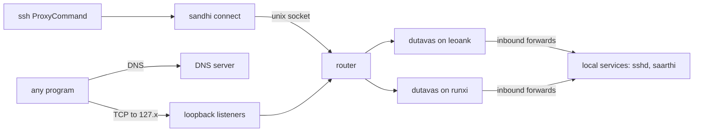

# sandhi - reach every network from every machine: architecture

The design of the code for [[PRJ-0001]]. Decisions with their alternatives are recorded one
per file in `decisions/`; this document says how the pieces fit and links them.

## Goals and constraints
- A machine reaches the peers of several networks at once by name, and is reachable in
  each of them, without switching its system tailnet (ADR-0001).
- Tailnets first; nothing above the backend layer may assume a tailnet.
- Coexists with a system tailscaled: never claims its tailnet's domain (ADR-0003), never
  touches its state.
- Configured by neusis on every machine; auth keys come from agenix secrets.
- Out: a gateway for devices with nothing installed, phones (saarthi embeds its own
  identity), exit nodes and subnet routes.

## Data model
- **Backend**: one network this machine is a member of, by name (`leoank`, `runxi`). Owns
  one or more DNS domains (`tail27b080.ts.net`); a domain is owned by one backend only.
- **Dutavas** (दूतावास, an embassy): the machine's identity on one backend, which dials
  out for it and receives callers on its behalf (ADR-0001). For a tailnet it is a tsnet
  identity; its state (the node key) lives in its own directory and is the only thing
  that is not rebuildable: losing it costs a new device and a new key.
- **Peer**: a machine on a backend, by name; the list comes from the backend and is
  derived, refreshed as it changes.
- **Target**: (backend, peer, port), what a front end asks the router for.
- **Forward**: (backend, port) to a local address, published inward.
- **Address**: a loopback address bound to one (backend, peer), derived and saved so it
  survives restarts (phase 2).

## Components

- `sandhi up` is the daemon: it starts every backend's dutavas, the router, the forwards and the
  front ends. One per user on shared machines (ADR-0001).
- `sandhi connect <host> <port>` speaks to the daemon over a unix socket and splices
  stdio, for ssh's `ProxyCommand` and `git` over ssh (phase 1).
- The DNS server and the loopback listeners (phase 2); the TUN (phase 3).

## Stack
- Rust 2024, tokio (ADR-0002).
- `crates/tailnet` (`sandhi-tailnet`): libtailscale's C API declared by hand; libtailscale
  `ac7ed43` built by the flake as a static archive (ADR-0002).
- Nix flake: the dev shell, `checks.workspace` (cargo build and test), `checks.notebook`.

## Phases
- Phase 0: the tailnet crate and the design. Check: `nix flake check`.
- Phase 1: `connect` and inbound forwards. Check: rogue reaches ghost001 on leoank while its
  system tailnet is runxi; ghost001 reachable on two tailnets at once.
- Phase 2: DNS with a loopback address per peer. Check: `curl https://<peer>.<tailnet>.ts.net`
  with its real certificate, with no proxy settings.
- Phase 3: a TUN. Check: mosh and an arbitrary port to a peer.

## Open questions
- Auth keys for machines × tailnets, without hand rotation.
- A peer-change notification from libtailscale, or polling, for DNS.
- The Rust userspace stack for the TUN.
